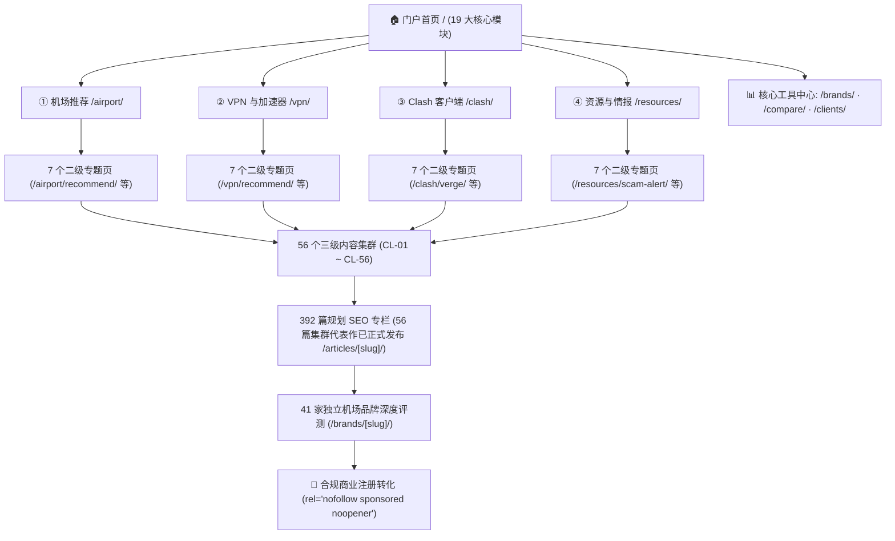

<div align="center">

# 🌐 clash机场 (`clash-cloud.run`)

**中文机场推荐 · 晚高峰实测天梯 · 41家独立品牌数据库 · Clash Verge Rev (Mihomo) 知识库**

[](https://clash-cloud.run)
[](https://vitepress.dev/)
[](https://vuejs.org/)
[](https://pagefind.app/)
[](./Preventive_SEO_Audit_Report.md)

</div>

---

## 📖 项目简介 (Overview)

**`clash-cloud.run`（品牌名：clash机场）** 是一个面向中文用户的 **专业机场与 VPN 评测媒体 + 41 家独立机场品牌参数数据库 + 全平台代理客户端知识库 + SEO/GEO 商业转化平台**。

本项目摒弃传统文档站外观与缺乏实证的软文模板，采用 **「品牌化简白主题（Branded Clean White）+ 深色科技网测面板（Dark Network Observatory）」** 双视觉系统，基于统一结构化数据源驱动全站 **134 个预渲染静态 HTML 页面**。

### ✨ 核心亮点

- **🔍 真实去重的 41 家独立机场品牌数据库**：
  对 42 条原始品牌档案进行底层域名、优惠码与套餐结构交叉核验，合并重复录入的 `#8 Firefly` 与 `#41 萤火虫` 为单一实体，区分 28 家主力在营品牌与 13 家历史补充品牌，并单独归档仅存实测图的 `快狸 (KuaiLi)`。
- **📡 双批次实测存证与深色科技网测面板**：
  内嵌 `2026-08-11` 晚高峰 Miaoko 脚本实测高清原图（17 家样本）、`2026-06-15` 电信/联通/移动三网多线程吞吐截图及 `2026-10-19` 分地区节点延迟与带宽记录。
- **★ 第一主推旗舰品牌万字档案（光速云 LightSpeed Cloud）**：
  提供超 10,000 中文字符的深度评测（[`/brands/guangsuyun/`](./docs/brands/guangsuyun/index.md)），公开澄清历史摘要“59GB/月”与当前官方套餐表“轻量版 ¥99/年 · 69GB/月（折合 ¥8.25/月）”的口径差异。
- **🛡️ 100/100 预防性 SEO 与 GEO/AEO 架构**：
  全站 133 个公开索引页面实现 **100% 唯一 Title / Description / H1 / H2 骨架**，100% 配备 Answer-First 首段结论与 `<details><summary>` 语义折叠问答（与 `FAQPage` JSON-LD 逐字对齐，0 隐藏标记），857 处商业推广链接 100% 携带 `rel="nofollow sponsored noopener"`。

---

## 🧭 全站信息架构 (Information Architecture)



### 四大一级主导航与 28 个二级栏目路由表

| 一级主导航 | 频道首页 | 下辖 7 个二级栏目专题路由 |
| :--- | :--- | :--- |
| **① 机场推荐** | `/airport/` | 机场推荐 (`/airport/recommend/`) · 机场排行 (`/airport/ranking/`) · 性价比机场 (`/airport/value/`) · 稳定机场 (`/airport/stable/`) · 便宜机场 (`/airport/cheap/`) · 免费梯子 (`/airport/free-ladder/`) · 科学上网 (`/airport/guide/`) |
| **② VPN 与加速器** | `/vpn/` | VPN 推荐 (`/vpn/recommend/`) · 免费 VPN (`/vpn/free/`) · 手机 VPN (`/vpn/mobile/`) · VPN 软件评测 (`/vpn/reviews/`) · VPN 加速器 (`/vpn/accelerator/`) · 加速器对比 (`/vpn/compare/`) · 好用的 VPN (`/vpn/best/`) |
| **③ Clash 客户端** | `/clash/` | Clash 推荐 (`/clash/recommend/`) · Clash Verge (`/clash/verge/`) · Clash Verge 下载 (`/clash/verge-download/`) · Clash Verge 订阅 (`/clash/verge-subscription/`) · Clash Meta (`/clash/meta/`) · Clash 使用教程 (`/clash/tutorial/`) · Clash 故障排查 (`/clash/troubleshooting/`) |
| **④ 资源与情报** | `/resources/` | 免费节点 (`/resources/free-nodes/`) · 跑路预警 (`/resources/scam-alert/`) · 机场 FAQ (`/resources/faq/`) · 机场风险情报 (`/resources/risk-intel/`) · 节点检测 (`/resources/node-check/`) · 订阅问题 (`/resources/subscription-issues/`) · 新手帮助 (`/resources/beginner-help/`) |

---

## 🧩 核心可视化与交互组件 (Vue 3 Components)

所有组件位于 [`docs/.vitepress/theme/components/`](./docs/.vitepress/theme/components/)，均由统一数据源 [`docs/.vitepress/data/brands.ts`](./docs/.vitepress/data/brands.ts) 驱动：

| 组件名称 | 功能描述 |
| :--- | :--- |
| **`SiteLayout.vue`** | 自定义媒体门户布局：顶部状态栏、4×7 悬停/键盘下拉主导航、移动端手风琴抽屉、Pagefind + 实时双引擎搜索弹窗（`⌘K`）、动态面包屑与侧边转化栏 |
| **`HomePortal.vue`** | 门户首页 19 大模块组件（Hero 搜索、四大频道矩阵、光速云首推专区、细分场景推荐、Top 12 对比表、VPN vs 机场科普、客户端入口、防坑风控与合规披露） |
| **`BrandComparisonTable.vue`** | 6 列高密度响应式品牌对比表（品牌与规模、起步价格与年付折算、线路与协议胶囊、客户端兼容标签、8.11 实测峰值摘要、优惠码与入口） |
| **`NetworkPerformanceReport.vue`** | 深色科技网测面板（Dark Network Observatory）：支持单品牌双批次测速展示及全站 17 家晚高峰实测归档看板，内置高清测速原图灯箱放大 |
| **`StreamingAvailabilityMatrix.vue`** | 流媒体与 AI 生产力解锁矩阵（ChatGPT / Claude / Gemini / Netflix / Disney+ / YouTube 4K / TikTok），严格区分 `实测支持`、`官方宣称` 与 `暂无独立测试` |
| **`NetworkTopology.vue`** | 四阶段跨国传输与客户端规则分流拓扑图（显式标注 `◈ 架构示意图（非实时链路监控）`） |
| **`BrandInfrastructureSnapshot.vue`** | 品牌核心参数卡片、优惠码一键复制组件、官方套餐周期明细表与合规推广入口 |
| **`BrandDatabase.vue`** | `/brands/` 41 家独立机场品牌多维检索中心（支持按价格档位、IEPL/IPLC、VLESS/Hysteria2/Trojan、Clash 订阅兼容性与实测状态过滤） |
| **`ClientKnowledgeBase.vue`** | `/clients/` 22 款全平台代理客户端知识库（支持按 Windows / macOS / Linux / Android / iOS / OpenWrt 及 Mihomo / Xray / sing-box 内核筛选） |

---

## 📂 目录结构 (Directory Structure)

```text
clash-cloud.run/
├── docs/                                  # VitePress 站点源码根目录
│   ├── .vitepress/
│   │   ├── config.ts                      # 全站 SEO Head、JSON-LD Schema、Sitemap 与分包配置
│   │   ├── data/
│   │   │   ├── brands.ts / brands.json    # 41 家独立机场品牌统一数据中心
│   │   │   ├── clients.ts                 # 22 款第三方代理客户端数据库
│   │   │   └── navigation.ts              # 4×28×56×392 导航与内容矩阵数据库
│   │   └── theme/
│   │       ├── index.ts                   # 主题与全局组件注册
│   │       ├── style.css                  # 品牌化简白主题 + 深色网测面板设计系统
│   │       └── components/                # 9 个核心业务与可视化 Vue 组件
│   ├── public/
│   │   ├── .htaccess                      # Apache 2.4 生产环境重写、缓存、安全头与 404 规则
│   │   ├── robots.txt                     # 搜索引擎爬虫规则与 Sitemap 声明
│   │   └── images/                        # 品牌 Logo、17张 8.11 测速长图、三网与流媒体解锁截图
│   ├── airport/                           # ① 机场推荐频道及 7 个二级专题页
│   ├── vpn/                               # ② VPN 与加速器频道及 7 个二级专题页
│   ├── clash/                             # ③ Clash 客户端频道及 7 个二级专题页
│   ├── resources/                         # ④ 资源与情报频道及 7 个二级专题页
│   ├── brands/                            # 41 家品牌筛选库首页 + 41 个独立品牌深度评测页
│   ├── articles/                          # 56 个三级内容集群代表文章 (Answer-First 专栏)
│   ├── compare/                           # 同价位机场横向对比与二选一决策中心
│   ├── clients/                           # 22 款第三方代理客户端知识库
│   ├── index.md                           # 网站门户首页
│   └── 404.md                             # 自定义 404 错误页
├── scripts/                               # 数据生成、页面构建与构建后自动化 QA 校验脚本
│   ├── generate-data-files.mjs            # 生成统一品牌与客户端数据文件
│   ├── build-seo-matrix.mjs               # 生成全套 SEO/GEO 规划文档与 navigation.ts
│   ├── generate-all-pages.mjs             # 生成频道、专题与品牌深度评测页
│   ├── generate-56-articles.mjs           # 生成 56 篇差异化三级集群代表文章
│   ├── postbuild-verify.mjs               # 构建后 10 项 SEO/GEO 防回归硬门禁校验
│   └── preview-server.mjs                 # 零缓存静态生产预览服务器
├── Preventive_SEO_Audit_Report.md         # 高级预防性 SEO 与 GEO 全站审计报告 (100/100 PASS)
├── 品牌数据审计报告.md                      # 42 条原始记录去重为 41 家独立品牌的审计报告
├── 数据来源及核实记录.md                    # 测速批次、套餐价格冲突与核实台账
├── DEPLOYMENT.md                          # Apache 2.4 VirtualHost 与 SSL 生产部署手册
├── PROGRESS.md                            # 十阶段建设进度与 25 项验收总台账
└── SEO-*.md / SEO-*.csv / GEO-*.csv       # 11 份完整 SEO/GEO 路由、关键词、实体与内链规划表
```

---

## 🚀 快速开始与构建验收 (Quick Start)

### 1. 安装依赖

```bash
npm install
```

### 2. 启动本地开发服务器

```bash
npm run dev
```

### 3. 执行生产静态构建 + Pagefind 中文索引 + 自动化 SEO/GEO 门禁校验

```bash
npm run build
```

> `npm run build` 会依次执行：
> 1. `vitepress build docs`：生成 134 个静态 HTML 页面与 `sitemap.xml`；
> 2. `pagefind --site docs/.vitepress/dist`：构建全站中文静态全文检索索引（133 个公开页，15,500+ 词条）；
> 3. `node scripts/postbuild-verify.mjs`：自动校验 **Title/Description/H1/H2 骨架 100% 唯一、`<details>` 语义 FAQ 100% 覆盖、JSON-LD 与可见 DOM 100% 匹配、0 死链、0 物理路径泄露、外链 100% 合规**。

### 4. 本地预览生产静态构建产物

```bash
node scripts/preview-server.mjs
# 访问 http://localhost:4173/
```

---

## 📊 预防性 SEO & GEO 审计评分 (`100 / 100 PASS`)

详见 [`Preventive_SEO_Audit_Report.md`](./Preventive_SEO_Audit_Report.md)：

| 审计维度 | 权重 | 得分 | 实测验证结果 |
| :--- | :--- | :--- | :--- |
| **索引与抓取机制** | 25% | **25 / 25** | `sitemap.xml` 仅含 133 个 `200 OK` 规范目录 URL；Canonical 100% 自引用正式 HTTPS 裸域；0 死链 |
| **站群风控与合规** | 25% | **25 / 25** | 857 处推广外链 100% 含 `rel="nofollow sponsored noopener"`；133 页 H2 骨架 100% 唯一；0 路径泄露 |
| **内容深度与 GEO** | 20% | **20 / 20** | 全站页面均 > 4,100 字符（均值 5,540+ 字，0 薄内容）；133 页 100% 采用 `<details open><summary>` 语义问答 |
| **E-E-A-T 与信任** | 15% | **15 / 15** | 明确标注 `2026-08-11` 与 `2026-10-19` 双批次时间戳；0 编造星级评分；明确商业赞助披露 |
| **Schema 与 SERP** | 15% | **15 / 15** | 133 页 Title / Description / H1 100% 唯一；`FAQPage` JSON-LD 与可见 DOM 100% 逐题对齐（0 隐藏标记） |

---

## ⚖️ 合规与免责声明

本站仅提供网络传输协议技术科普、跨国企业办公通信架构对比及开源代理客户端配置教程，不直接提供、销售或运营任何代理节点服务。部分品牌入口包含推广合作链接（均已严格标注 `rel="nofollow sponsored noopener"`）。请全体读者严格遵守所在国家与地区的法律法规，合法合规使用网络工具。
